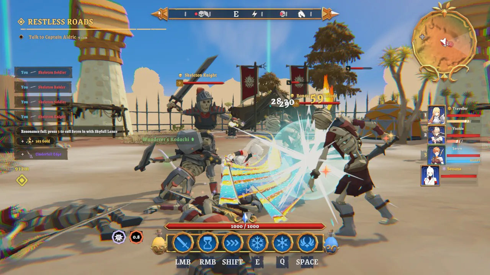

上周我用 Claude Opus 5.5 做了一个游戏。最初的设想是一个风格化的开放世界。我把这个想法交给 Opus，然后和它一起迭代了五天，到现在我还是有点惊讶它最后做到了这个程度。它在视觉和空间推理上的表现，远远超过我以前用过的任何模型；成本也让人没话说：整整一周，我 200 美元的订阅就撑下来了。这篇文章里展示的版本，大约用了 65 小时的智能体工作时间和 55 亿左右的 token。如果按 API 标价算，大概要 1,650 美元。

先说游戏本身，再说我是怎么评审它的。后者才是我最想推荐给别人照搬的部分。

## 这是个什么游戏

它叫 Token Isles（代码仓库叫 TokenImpact），是一个设定在海岛上的第三人称动作 RPG。

### 第一次生成就说得通的世界

岛屿边长 2 公里，分成十个生物群系：起始小镇周围的绿色林地、有城塞的雪原高地、带天守阁的樱花岛、红岩峡谷、沼泽、珊瑚环礁，还有一个叫 the Hollow 的紫色陨坑，等等。这是最让我吃惊的地方。我只给了 Opus 一张高度图，它第一次生成的世界就已经说得通了：海岸线贴合地形，群系之间过渡自然，道路也都通向某个地方。几个月前我试过类似的事，结果完全没法比。

[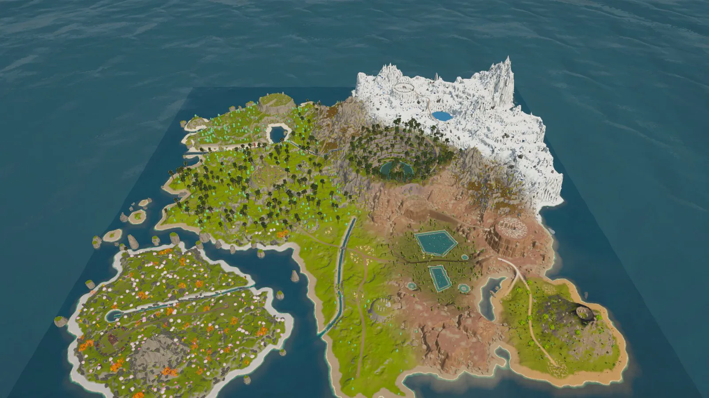](/assets/images/review-is-all-you-need/world-round1.webp)
*第 1 轮：Opus 生成的第一个世界，那时我还没给过任何反馈。*

我以前一直以为，做世界构建需要一个单独的 PCG 框架，比如一套节点图或者某种程序化工具，让模型去驱动。这一周之后，我觉得这件事已经没那么重要了。Opus 边做边写出了自己的生成器（高度、地形、地点、道路、水体、树木、道具、寻路、游戏内地图），而且每一轮都在改进。模型自己就能把世界想明白。

[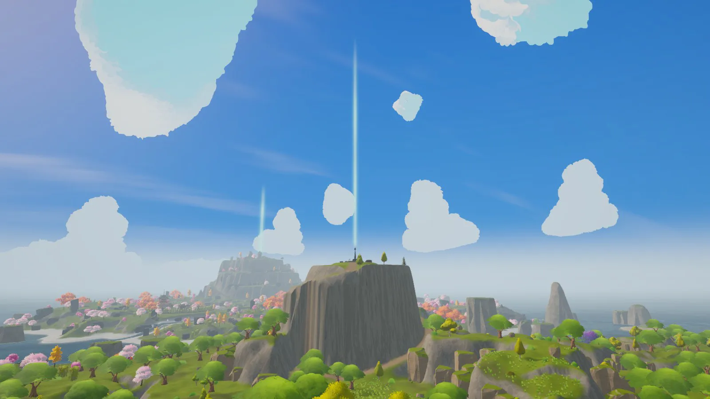](/assets/images/review-is-all-you-need/vista-windhaven.webp)
*第 11 轮，从起始小镇向外看。每一道光柱都是一个区域的祭坛。*

### 卡通的角色，卡通的世界

整体都是风格化的：块面感很强的低多边形场景、柔和的雾气，加上卡通渲染的角色。玩家操控一支四人小队。

[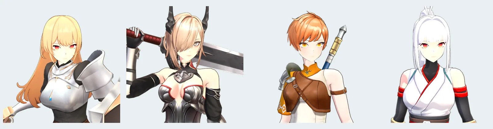](/assets/images/review-is-all-you-need/party.webp)
*Jojio（剑盾）、Ysolde（大剑）、Seren（长枪）和 Setsuna（双刀）。*

### 去探索，一路结识伙伴

结构上是塞尔达那一类：你去探索，世界随之一点点展开。每个区域一开始都笼罩在战争迷雾里，要找到它的祭坛（通常在附近最高的山顶上）并与之共鸣，地图才会被点亮。路边的路标石可以祈祷、回血，战败后也会在那里重新站起来。试炼和宝箱藏在各个角落。伙伴会在旅途中陆续加入。我写这篇文章的时候，智能体正在做第二章：三位同伴会分别在以各自故乡为舞台的那一幕里加入队伍。

### 切人连携与破盾

战斗借鉴了幻塔。你几乎随时都能用数字键切换女主角，连招打到一半也行。命中敌人会给替补席上的队友充能，切入一位已经充满的队友，就会释放她的共鸣技，一段带专属镜头的短小演出攻击。几秒内再切入另一位充满的队友，她的共鸣技就会接着上一段形成连锁，伤害更高。第 12 轮加入了护盾：Boss 和精英会架起韧性护盾，在你把它打破之前吸收大部分伤害；护盾一破，敌人会被打出硬直，并在六秒内承受双倍伤害。

### 简单经典的装备系统

装备系统刻意做得很传统。每种武器类型都有五个稀有度，饰品成套出现，有两件套和四件套加成；可以花金币和矿石强化，用不上的就分解掉。战利品掉落时会亮起一道对应稀有度颜色的光柱，传说品质隔着一片原野都看得见。

### 不用生成式素材

游戏里没有任何生成出来的美术资源。所有东西都来自 Unity Asset Store 上买的素材包：场景用 Synty 的 POLYGON 系列，女主角用 CombatGirls，动画来自 Kevin Iglesias，特效用 Epic Toon FX，再加上几套音乐和音效。生成式 3D 素材离我的标准还差得远，就算用了也得有美术再过一遍。所以这次实验我假设美术团队已经把需要的素材都交给我了。素材库放在一块外置硬盘上（267 个素材包，约 32.3 万个资源，165 GB）。Opus 用一个小命令行工具给它建了索引，需要什么就连同依赖一起只拉单个预制体，不整包导入，所以项目本身只有 3.8 GB。

### 我一次都没碰过 Unity

我做的事情只有两件：给方向，以及评审 Claude 发布的报告。我自己一次都没有打开过 Unity。Claude 通过 Unity CLI 操作编辑器，用的是它自己写的脚本；它还维护着一份自己的命令手册，所以每次开新会话都是从已经验证可用的命令开始。

### 现在做到了哪一步

下面是大约 65 小时的智能体工作、外加我十轮反馈之后的样子。片段都来自第 11 轮。

<div class="yt-grid">







</div>

## 评审真的就是你所需要的一切

当模型能把东西看得这么准、摆得这么对，瓶颈就转移到了我身上：我能评审得多快，又能多精确地说出哪里不对。所以第一天我就告诉 Claude 我想怎么评审。我要看它工作成果的真实屏幕截图和视频，而且要能直接在上面画：钉一个图钉、拉一个框、在某一帧上圈出一块，写一句话，然后让这句话送到智能体手里。

它就照这个做出来了。

[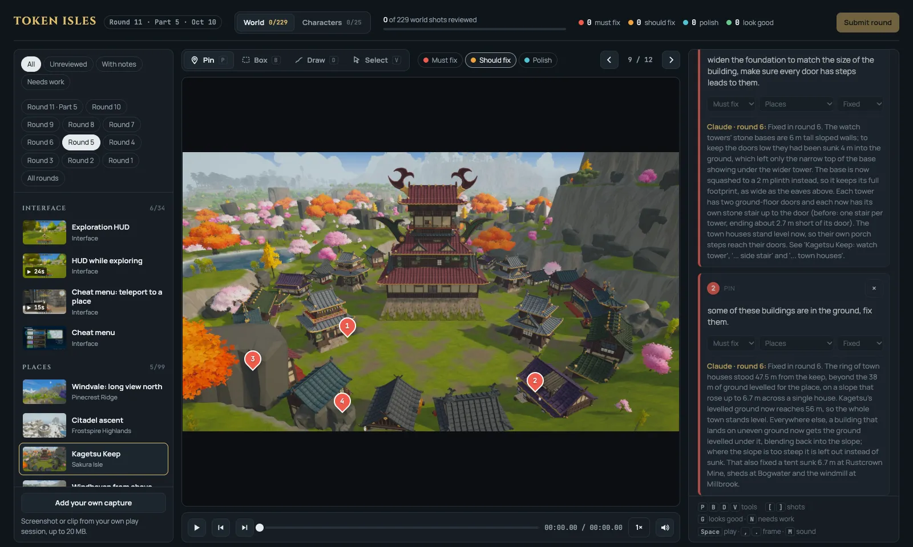](/assets/images/review-is-all-you-need/review-page-pins.webp)
*评审页面。左边是镜头，中间是画面和标注工具，右边是批注。第 5 轮 Kagetsu Keep 上的四个图钉各是一个问题，每个都有智能体在第 6 轮的回复。*

评审基本靠键盘完成。`P`、`B`、`D`、`V` 切换图钉、框选、手绘和选择，`G` 和 `N` 把镜头标成“没问题”或“要改”，`[` 和 `]` 切换镜头，`,` 和 `.` 逐帧步进。筛选器可以按轮次列出我还没看过的镜头。整个循环里最慢的是我，所以任何能让我更快的东西，每一轮都会有回报。

### 一条批注在智能体眼里长什么样

批注很小。下面这条是真实的，来自第 3 轮：

```json
{
  "media": "hud-explore@r3",
  "t": 11.474,
  "shape": "pin", "x": 0.2987, "y": 0.8756,
  "severity": "must",
  "category": "UI & HUD",
  "text": "This ui of bottles are taking to much spaces,",
  "status": "fixed",
  "reply": "Fixed in round 4. The stamina and energy flasks are now…",
  "replyRound": 4
}
```

它写明了是哪个镜头、哪一轮，片段里精确到帧的时间，相对画面的标记坐标，严重程度（must fix、should fix 或 polish），一个分类，再加一句话。图钉和时间戳已经说明了在哪里、在什么时候，所以那句话可以写得又短又随意。我就是这么写的。

[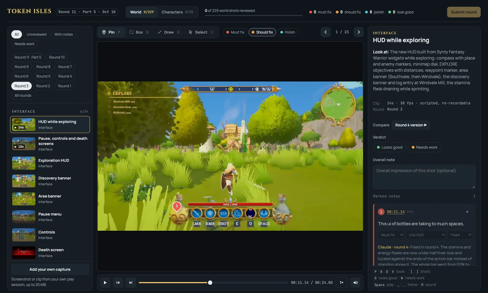](/assets/images/review-is-all-you-need/review-hud-note.webp)
*页面上的同一条批注（“这排药瓶 UI 太占地方了”）。回复的内容是：药瓶缩到原来的一半以下，挪到动作栏两端，整条动作栏占屏幕的宽度从 52% 降到 41%。*

在智能体那一侧，一个图钉会变成一张它能看的图。一个小工具从片段里取出那一帧，另一个在图钉位置画个圈，再在旁边输出一张 2 倍放大的局部图。

[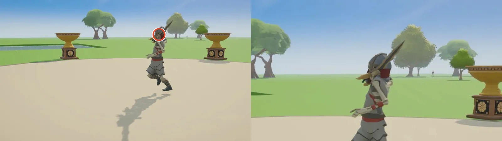](/assets/images/review-is-all-you-need/agent-view.webp)
*“In attack 3, the sword is going through the character's body”（第三段攻击时剑穿过了角色身体），这是智能体看到的样子。它在第 6 轮的修复：实测剑刃插进头盔 17 到 36 厘米，于是把第三段攻击换成同一素材包里另一个能保持 6 厘米间距的动画，并同时应用到三种骷髅身上。*

### 视频比截图有用

我没想到视频会这么重要。一个游戏“感觉不对”的地方，大多发生在时间维度上，静帧根本表现不出来。

有一条批注说第三段攻击“seems to be cancelled by another attack when it shouldn't”（不该被另一次攻击打断，却被打断了）。没有哪一帧能单独表现出一次攻击被截断。智能体找到了两个原因：它把这段攻击截在了挥砍的 74% 处，而录制器本身也一直在以一半的速度播放所有片段。

[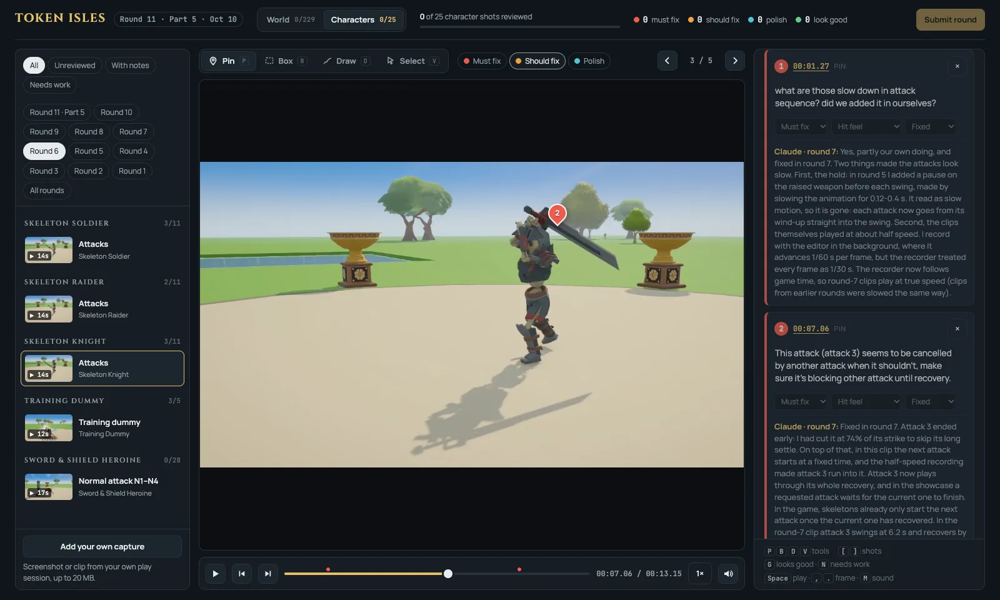](/assets/images/review-is-all-you-need/review-timing-note.webp)
*片段上的时机类批注。我问这个减速是不是我们自己加的，智能体回答“是的，部分是我们自己造成的”（Yes, partly our own doing），并解释了两个原因。*



另一条批注钉在路标石祈祷片段的 11.7 秒处，只写了一句“Let's not transition the camera angle on this interaction”（这个交互不要切换镜头角度）。这条后来成了整个项目的规则：任何交互都不移动镜头。还有一条批注说所有录像的音频都有卡顿。结果问题出在录制器，而不在游戏。Unity 的离线音频渲染器只按完整的 1,024 采样块混音，录制器却每帧要 1,600 个采样，于是每一帧末尾都有 12 毫秒的静音。所有带声音的片段都重新录了一遍。

[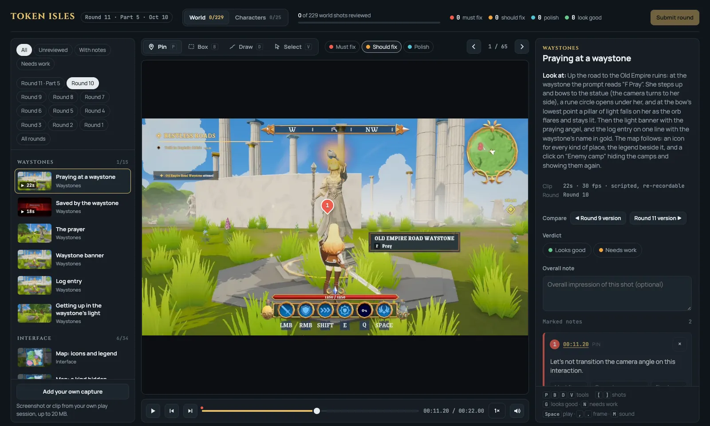](/assets/images/review-is-all-you-need/review-video-note.webp)
*钉在视频时间戳上的镜头类批注。右侧的 “Look at” 是智能体对这个片段应该呈现什么的说明，所以我是在核对它的说法，而不是去猜它改了什么。*



### 布局问题用静帧

静帧仍然是看位置关系的合适工具。在 Kagetsu Keep 的一张静帧上，我钉了四个图钉：地基太窄、房子陷进地里，以及两处石头插进了建筑。修复并没有只停留在这一个地方：现在建在不平地面上的建筑，下面的地面都会被整平；石头、悬崖块和树木在所有地方都会避开建筑的占地范围。之后智能体检查了岛上全部 516 座建筑，没有发现任何东西和建筑相交。

[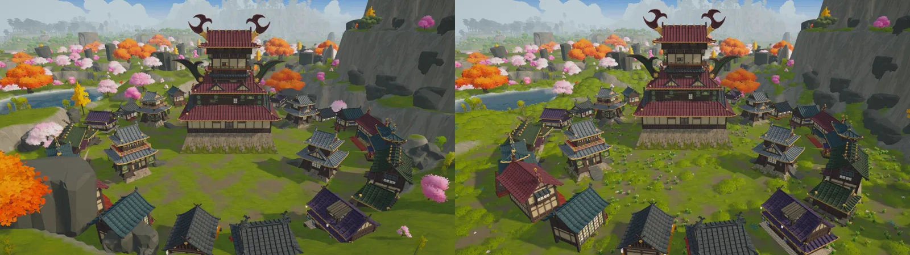](/assets/images/review-is-all-you-need/kagetsu-r5-r6.webp)
*同一机位下的第 5 轮和第 6 轮。静帧是按记录下来的相机位姿拍的，所以“修改后”能精确复现“修改前”的镜头。*

### 智能体那一半的工作

图钉要起作用，智能体也得把它那一半做好，而它确实做到了。每个镜头都附带一行 “Look at”，说明改了什么、该看什么。角色片段旁边附有数值（伤害、攻击范围，以及命中、输入和取消的时间窗口条），让我可以拿手感去对照设计意图。对比按钮可以跳到同一个镜头更早或更晚的版本。每条批注都有回复，写明在哪一轮修好；如果问题是智能体自己造成的，回复里也会直说。

[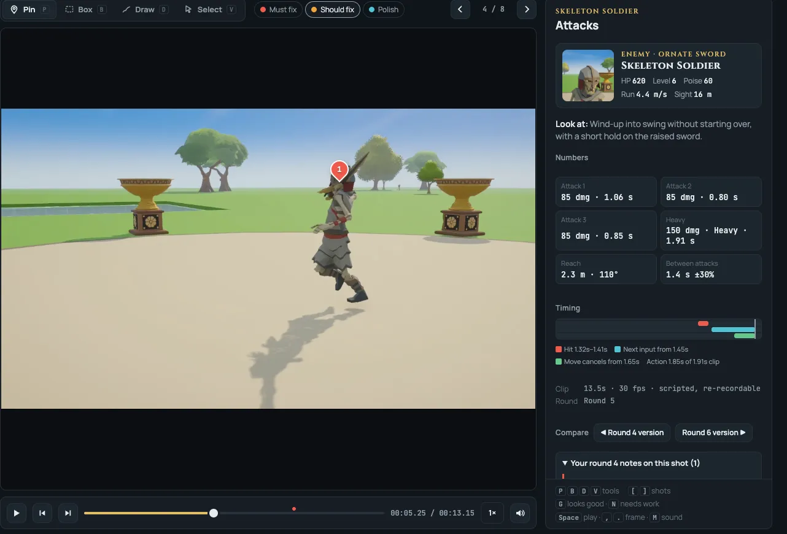](/assets/images/review-is-all-you-need/soldier-numbers.webp)
*带图钉的片段，旁边是智能体给角色片段附上的数值。*

录像本身也必须可信。评审抓到的问题里，有三个出在录像上，而不在游戏里：第 7 轮之前片段一直以一半速度播放，第 8 轮采集时计时器快了约 7 倍，还有就是音频空洞。脚本化片段还会记下每一次因为玩家自己的操作没生效、不得不直接调用 API“作弊”的步骤，这样的录制会被重录，或者被标出来。会说谎的录像比没有录像更糟。

## 让这一切成立的是 artifact

这些评审页面都是 Claude artifact：Claude 发布到 claude.ai 上的网页，默认私有，网址固定。页面能用上的三样东西，把它从一个画廊变成了评审工具。一是页面和智能体共享的一个小数据库：我的批注、每个镜头的结论和每一轮的提交都写进去，智能体读取它们，再把回复写回同一条记录。二是页面知道谁在看。三是我可以上传自己试玩时录的截图或片段，像其他镜头一样标注。重新发布会替换页面和素材，但数据库保持不变，所以批注能一轮轮保留下来。

这也意味着我可以在任何地方评审。我在另一台电脑上看一轮，工作站同时继续处理反馈和功能待办。看完以后，我点 Submit，在聊天里说一声 “done”，智能体就会读取批注、修复问题、逐条回复，然后录制下一轮。

### 把一整个游戏的视频塞进页面

Artifact 有体积限制：单个文件 16 MB，单次发布 64 MB、255 个文件（服务器端复制也算在内），每个页面 256 MB。仅第 11 轮就新增了约 650 MB 的片段和静帧。第 10 轮之后我定了规矩：不许为了装进页面而降低质量。下面这些做法让它装得下：

- 片段用 H.264 加 AAC，宽 1280，3 Mbps。只有会超过 15.5 MB 的片段才降码率，镜头列表先加载小缩略图和封面。
- 一个页面满了，下一轮就开新页面。第 11 轮一轮就分成了五个按主题拆分、互相链接的页面。
- 每个页面都是同一份 HTML。镜头、轮次和旧批注都放在清单（manifest）里，每一轮只往里加，从不删减。
- 页面分批发布到同一个网址：先发页面、清单和静帧，让页面马上能用，再发视频。
- 重做过的镜头，旧版本直接在服务器端从旧页面复制过来，不重新上传，这样对比按钮还能用。
- 发布前用一个一分钟的脚本检查体积、批次和引用。

[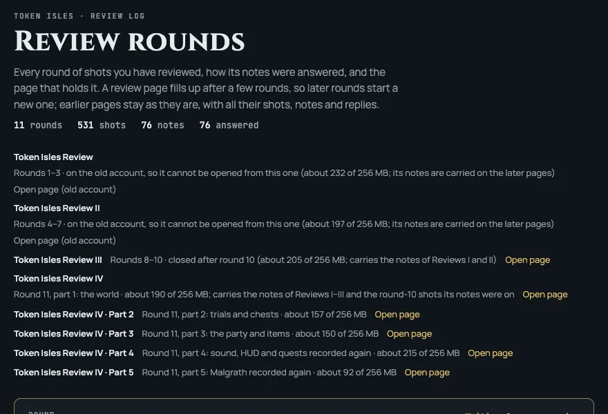](/assets/images/review-is-all-you-need/rounds-index.webp)
*轮次索引页列出了每个页面以及它有多满。*

所有东西，包括素材、清单和导出的批注，也都存在 git 里。这一点在我换到新的 claude.ai 账号时派上了用场：前两个评审页面从新账号已经打不开了，但每一条批注和回复都还在，因为后来的每个页面都带着它们，导出的文件也在仓库里。

五天时间，这个游戏从一座生成出来的岛屿，变成了可以玩的东西：在十个生物群系之间滑翔，战斗中途切换女主角，攻打要塞，解开试炼，打开宝箱，借助一座座祭坛点亮地图，再打败一个两阶段的 Boss。每一项在手感对之前都经过了不止一轮评审。动手构建的是 Opus；我的部分是看得仔细，再把哪里不对说清楚。我花在让这件事更快的每一个小时，都在之后的每一轮里得到了回报。
