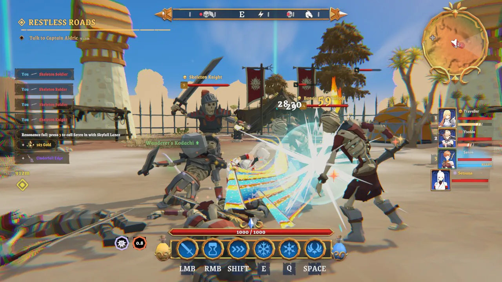

I spent last week making a game with Claude Opus 5.5. The pitch was a stylized open world. I gave Opus the idea, iterated on it with Opus for five days, and I'm still a little amazed at where it ended up. Its visual and spatial reasoning is far beyond anything I'd seen from a model before, and the cost is hard to argue with: the whole week ran on my $200 subscription. The version in this post took about 65 hours of agent work and around 5.5 billion tokens. At API list prices that would have been roughly $1,650.

First the game, then the way I reviewed it, which is the part I'd tell anyone to copy.

## What the game is

It's called Token Isles (the repo is TokenImpact), a third-person action RPG set on an island.

### A world that made sense on the first try

The island is 2 km on each side, split into ten biomes: green woodland around the starting town, snowy highlands with a citadel, a sakura isle with a castle keep, red-rock canyons, a marsh, a coral atoll and a violet crater called the Hollow, among others. This is what surprised me most. I handed Opus a height map, and the very first world it generated already made sense. Coasts follow the land, biomes blend at their borders, and roads lead somewhere. I tried something similar a few months ago and got nothing close to this.

[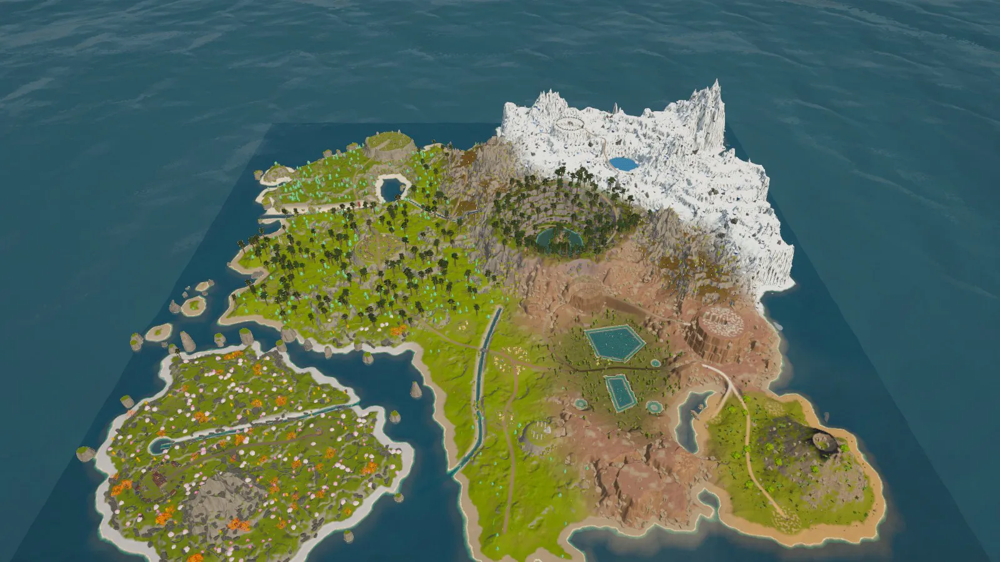](/assets/images/review-is-all-you-need/world-round1.webp)
*Round 1: the first world Opus generated, before I had given any feedback.*

I used to assume world building needed a separate PCG harness, some node graph or procedural tool for the model to drive. After this week I don't think that matters nearly as much as it used to. Opus wrote its own generator as it went (heights, terrain, places, roads, water, trees, props, navigation, the in-game map) and improved it every round. The model figures the world out by itself.

[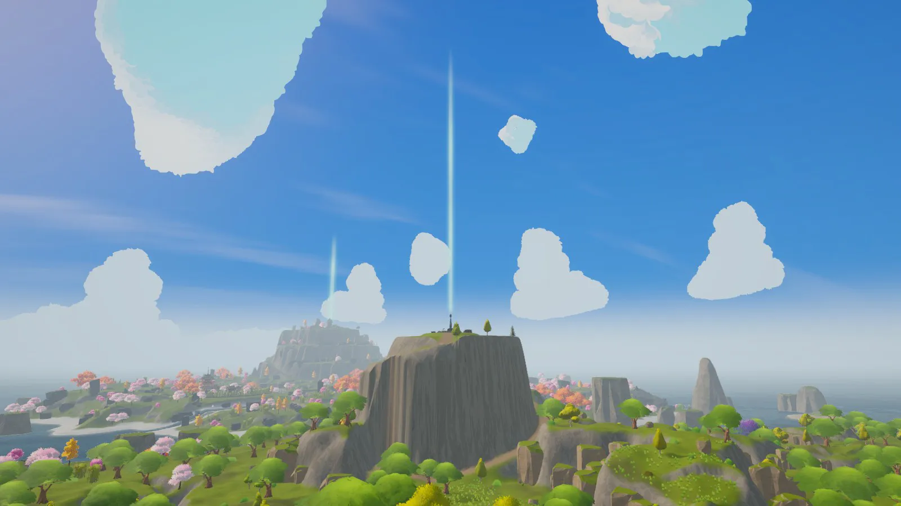](/assets/images/review-is-all-you-need/vista-windhaven.webp)
*Round 11, looking out from the starting town. Each column of light is a region's altar.*

### Cartoon characters in a cartoon world

Everything is stylized: chunky low-poly scenery, soft fog and toon-shaded characters. You play a party of four.

[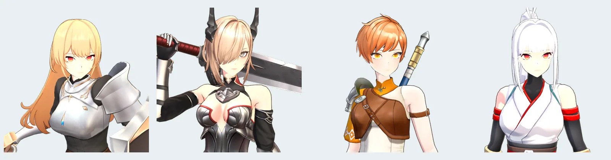](/assets/images/review-is-all-you-need/party.webp)
*Jojio (sword and shield), Ysolde (greatsword), Seren (spear) and Setsuna (twin katanas).*

### Explore, and gather friends

The structure is the Zelda kind: you explore, and the world opens up as you go. Every region starts under a fog of war, and you chart it by finding its altar, usually on the highest peak around, and attuning it. Waystones along the roads are where you pray, heal and get back up after a defeat. Trials and chests are tucked away everywhere. Friends join along the way. Chapter two, which the agent is building while I write this, has each of the three companions join during an act set in her homeland.

### Tag combos and shield breaks

Combat takes after Tower of Fantasy. You swap heroines with the number keys almost any time, even in the middle of a combo. Hits charge the heroines waiting on the bench, and swapping in one who is fully charged fires her Resonance Art, a short cinematic attack with its own camera. Swap in another charged heroine within a few seconds and her Art chains off the last one for extra damage. Round 12 adds shields. Bosses and elites raise a poise shield that soaks most of the damage until you wear it down, and breaking it leaves the enemy staggered and taking double damage for six seconds.

### Simple, classic gear

Gear is deliberately old-school. Every weapon type comes in five rarities, relics come in sets with 2- and 4-piece bonuses, and you can enhance with gold and ore or salvage what you don't need. Loot drops with a beam of light in its rarity color, so you can spot a Legendary from across a field.

### No generated assets

There's no generated art anywhere in the game. Everything comes from packs bought on the Unity Asset Store: Synty's POLYGON series for the world, the CombatGirls pack for the heroines, Kevin Iglesias animations, Epic Toon FX, plus a few music and sound libraries. Generated 3D assets don't come close to my standard yet, and they'd still need an artist's touch. So I ran the experiment as if my art team had already handed over everything I needed. The library sits on an external drive (267 packages, about 323,000 assets, 165 GB). Opus indexed it with a small command-line tool and pulled in single prefabs with their dependencies instead of whole packs, which keeps the project itself at 3.8 GB.

### I never touched Unity

All I did was direct, and review the reports Claude published. I didn't open Unity once. Claude drove the editor through the Unity CLI with scripts it wrote for itself, and it kept a runbook of its own commands so each new session started from things that already worked.

### Where it is now

This is the game after about 65 hours of agent work and ten rounds of my feedback. The clips are from round 11.

<div class="yt-grid">







</div>

## Review is really all you need

When a model can see and place things this well, the bottleneck moves to me: how fast I can review, and how precisely I can say what's wrong. So on day one I told Claude how I wanted to review. I wanted real screen captures and videos of its work, and I wanted to draw on them. Drop a pin, drag a box, circle something on a frame, type one sentence, and have that reach the agent.

It built exactly that.

[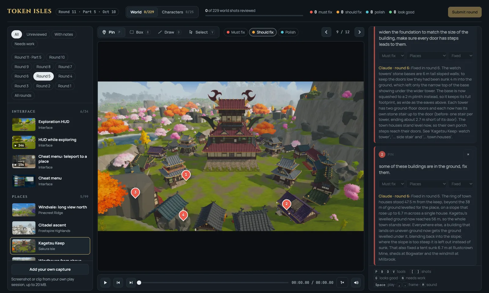](/assets/images/review-is-all-you-need/review-page-pins.webp)
*The review page. Shots on the left, the frame and mark-up tools in the middle, notes on the right. Each of the four pins on round 5's Kagetsu Keep is its own problem, and each has the agent's reply from round 6.*

Reviewing is mostly keyboard. `P`, `B`, `D` and `V` switch between pin, box, draw and select, `G` and `N` mark a shot good or needing work, `[` and `]` move between shots, and `,` and `.` step a single frame. Filters show what I haven't reviewed yet, by round. I'm the slowest part of the loop, so anything that makes me faster pays off every round.

### What a note looks like to the agent

A note is small. This one is real, from round 3:

```json
{
  "media": "hud-explore@r3",
  "t": 11.474,
  "shape": "pin", "x": 0.2987, "y": 0.8756,
  "severity": "must",
  "category": "UI & HUD",
  "text": "This ui of bottles are taking to much spaces,",
  "status": "fixed",
  "reply": "Fixed in round 4. The stamina and energy flasks are now…",
  "replyRound": 4
}
```

It names the shot and its round, the time in the clip to the frame, the mark in coordinates relative to the frame, a severity (must fix, should fix or polish), a category and one sentence. The pin and the timestamp already say where and when, so the sentence can be short and sloppy. Mine were.

[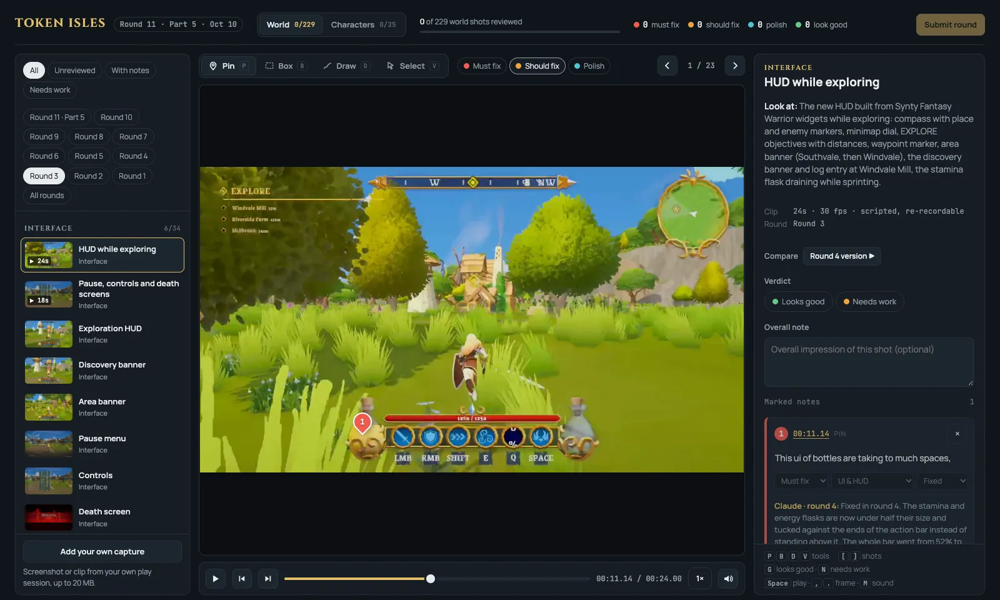](/assets/images/review-is-all-you-need/review-hud-note.webp)
*The same note on the page. The reply: the flasks shrank to under half their size and moved to the ends of the action bar, and the bar went from 52% to 41% of the screen width.*

On its side, the agent turns a pin into a picture it can look at. One small tool pulls the exact frame out of the clip, and another draws a ring at the pin and writes a 2× crop next to it.

[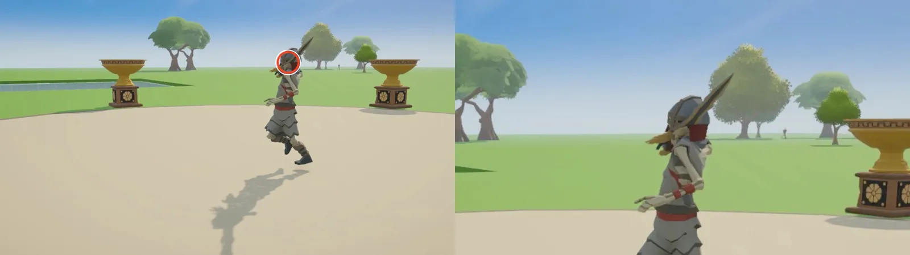](/assets/images/review-is-all-you-need/agent-view.webp)
*"In attack 3, the sword is going through the character's body", as the agent sees it. Its fix in round 6: it measured the blade going 17 to 36 cm into the helmet, swapped attack 3 for another clip from the same pack that keeps 6 cm clear, and applied that to all three skeleton types.*

### Video beats screenshots

I didn't expect video to matter this much. Most of what makes a game feel wrong happens over time, and a still can't show it.

One note said attack 3 "seems to be cancelled by another attack when it shouldn't". No single frame shows an attack getting cut short. The agent found two causes: it had trimmed the attack at 74% of its swing, and the recorder itself was playing every clip at half speed.

[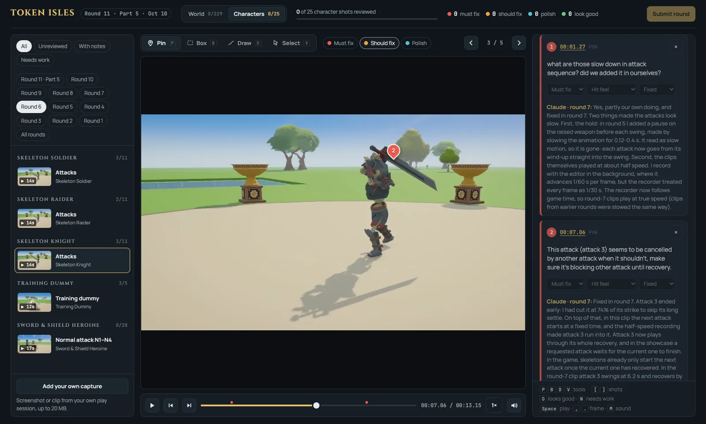](/assets/images/review-is-all-you-need/review-timing-note.webp)
*Timing notes on a clip. I asked whether we'd added the slowdown ourselves, and the agent answered "Yes, partly our own doing" and explained both causes.*



Another note, pinned at 11.7 s of the waystone prayer, just said "Let's not transition the camera angle on this interaction." That one became a rule for the whole project: no interaction moves the camera. And one note said the audio in every recording stuttered. It turned out to be the recorder, not the game. Unity's offline audio renderer only mixes whole blocks of 1,024 samples, and the recorder asked for 1,600 per frame, so every frame ended in 12 ms of silence. Every clip with sound was recorded again.

[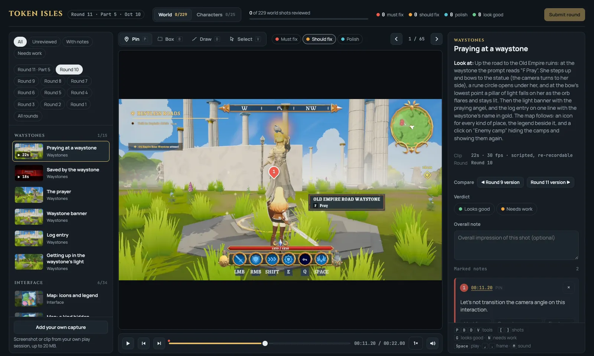](/assets/images/review-is-all-you-need/review-video-note.webp)
*A camera note on a video timestamp. The "Look at" text on the right is the agent's description of what the clip should show, so I'm checking its claims instead of guessing what changed.*



### Stills for layout

Stills are still the right tool for where things are. On one still of Kagetsu Keep I put four pins: foundations too narrow, houses sunk into the ground, and rocks running into buildings in two places. The fixes went beyond that one place. Buildings on uneven ground now get the ground leveled under them, and rocks, cliffs and trees stay out of every building's footprint everywhere. The agent then checked all 516 structures on the island and found nothing touching a building.

[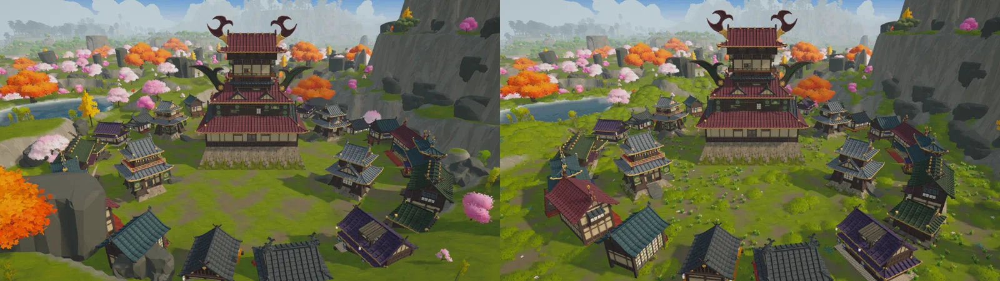](/assets/images/review-is-all-you-need/kagetsu-r5-r6.webp)
*Round 5 and round 6 from the same camera. Stills are shot from recorded camera poses, so an after shot repeats its before shot exactly.*

### The agent's half

A pin only helps if the agent meets it halfway, and it did. Every shot comes with a "Look at" line saying what changed and what to check. Character clips come with their numbers (damage, reach, and the hit, input and cancel windows drawn as a bar), so I can judge feel against intent. Compare buttons jump to the same shot in earlier and later rounds. Every note gets a reply that names the round with the fix, and when the bug was the agent's own doing, the reply says so.

[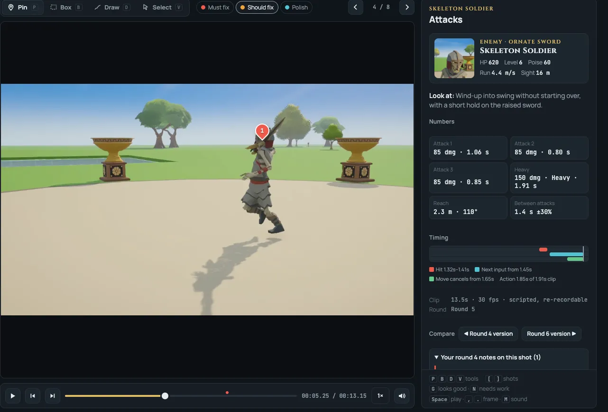](/assets/images/review-is-all-you-need/soldier-numbers.webp)
*A pinned clip next to the numbers the agent attaches to character clips.*

The footage has to be honest, too. Three of the bugs review caught were in the recordings rather than the game: clips running at half speed until round 7, timers running about 7× fast during capture in round 8, and the audio holes. Scripted clips also count every time a step had to cheat with a direct API call because the player's own move didn't land, so a take like that gets recorded again or flagged. Footage that lies is worse than no footage.

## Artifacts are what made it work

The review pages are Claude artifacts: web pages Claude publishes to claude.ai, private by default, at a fixed URL. Three things the page can use turn it from a gallery into a review tool. There's a small database the page and the agent share, so my notes, verdicts and round submissions land there, and the agent reads them and writes its replies into the same records. The page knows who's viewing. And I can upload my own screenshot or clip from a play session and mark it up like any other shot. Republishing replaces the page and its media but keeps the database, so the notes survive every round.

It also means I can review from anywhere. I go through a round on another computer while the workstation keeps working through the feedback and the feature backlog. When I'm done, I press Submit, type "done" in the chat, and the agent picks the notes up, fixes them, replies on each one and records the next round.

### Fitting a game's worth of video

Artifacts have limits: 16 MB per file, 64 MB and 255 files per publish (server-side copies count too), and 256 MB per page. Round 11 alone was about 650 MB of new clips and stills. A few habits made it fit without lowering quality, which was my rule after round 10:

- Clips are H.264 with AAC at 1280 wide and 3 Mbps. Only a clip that would pass 15.5 MB gets a lower bitrate, and the reel loads from small thumbnails and posters.
- When a page fills up, the next round starts a new page. Round 11 alone is five linked pages, split by subject.
- Every page is the same HTML. The shots, rounds and old notes live in a manifest that each round extends and never trims.
- A page goes up in batches to the same URL: the page, manifest and stills first so it's usable at once, then the videos.
- Earlier versions of redone shots are copied over on the server from the older page instead of re-uploaded, so the compare buttons keep working.
- A one-minute script checks sizes, batches and references before anything is published.

[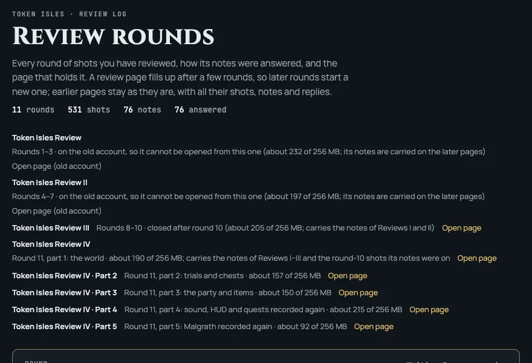](/assets/images/review-is-all-you-need/rounds-index.webp)
*The rounds index lists every page and how full it is.*

All of it, media, manifests and the exported notes, also lives in git. That paid off when I moved to a new claude.ai account and the first two review pages wouldn't open from it anymore. Every note and reply survived, because each later page carries them forward and the exports were in the repo.

In five days the game went from a generated island to something you can play: glide over ten biomes, swap heroines in the middle of a fight, storm forts, solve trials, open chests, chart the map altar by altar and beat a two-phase boss. Each of those went through review more than once before it felt right. Opus did the building. My part was looking closely and saying precisely what was wrong, and every hour I spent making that faster paid off in every round after it.
