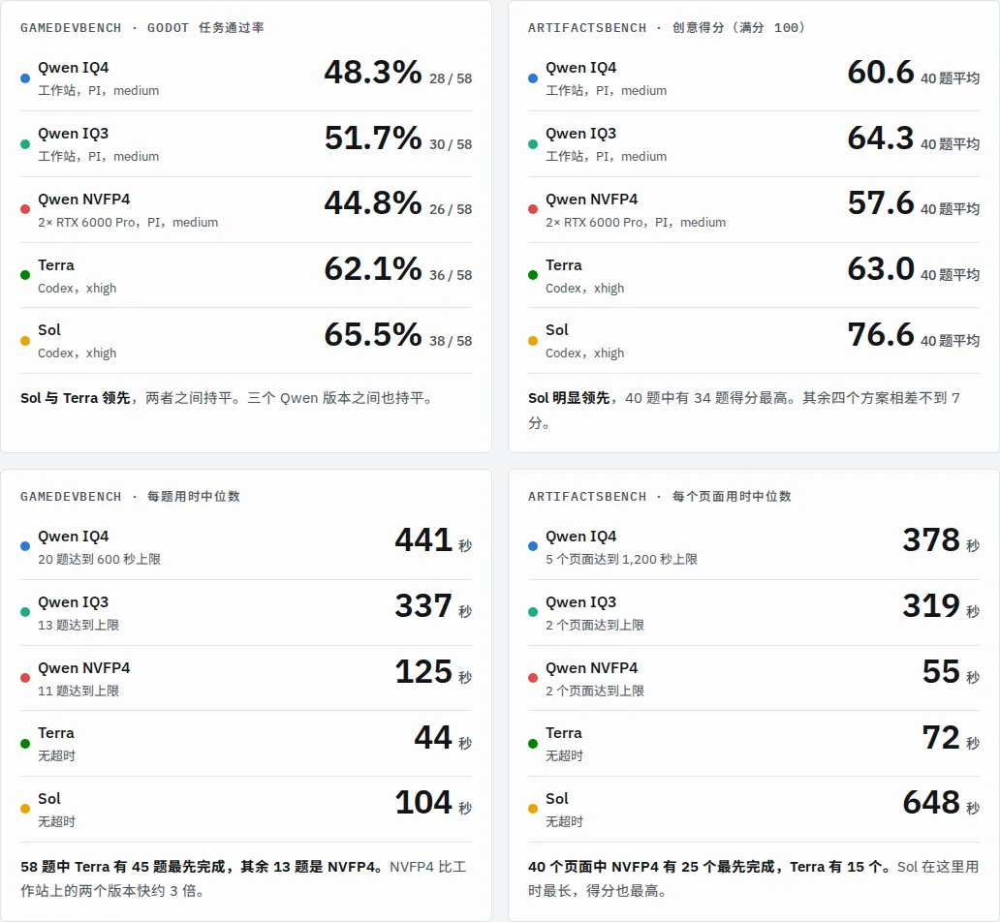

*主要数据，摘自[完整测试报告](/assets/reports/qwen-flash-benchmark/zh.html)。*

Strata 最近成为本地 LLM 社区里最火热的项目之一。这周我用 GameDevBench 和 ArtifactsBench 抽了 100 道题，粗略比较了本地部署的 Qwen 3.8 Flash Next 和 GPT-6.1 Sol、GPT-6.1 Terra。想回答四个问题，先给结论：

1. **Qwen 3.8 Flash Next 和 Sol/Terra 这样量大管饱的主力模型差多少？** Godot 游戏开发任务上落后 10 到 20 个百分点；创意网页上和 Terra 同一档，但和 Sol 差一大截；速度上 Strata 比 Terra 慢 4 到 10 倍。
2. **IQ3_S 和 IQ4 是否真的几乎没有差距？** 是的。这次 IQ3_S 甚至略好一点（在噪声范围内），而且更快。
3. **正常版 IQ4 和破甲 IQ4 差距几何？** 几乎为零，两个基准上都测不出差别。
4. **换到高性能推理硬件，超时能改善多少？和 Strata 比有没有区别？** 两张 RTX 6000 Pro 上用 SGLang 跑 NVFP4，用时降到原来的 1/3 到 1/7，Godot 超时从 20 题降到 11 题。但质量没有跟着变好，创意页面反而是五套方案里最差的。

## 怎么测的

五套方案加一个参考版本，每套都是模型、推理服务和智能体框架的完整组合。三个 Qwen 方案用同一个框架和设置，只有量化和硬件不同。

| 方案 | 模型与量化 | 推理服务与硬件 | 智能体框架 | 推理强度 |
| --- | --- | --- | --- | --- |
| Qwen IQ4 | Qwen 3.8 Flash Next，Unsloth UD-IQ4_XS | Strata，RTX 5070 Ti 16 GB + 128 GB DDR4-3200 + Ryzen 9 5950X，约 57 token/秒 | PI 1.4.0 | medium |
| Qwen IQ3 | 同上，IQ3_S | 同一台工作站，约 75 token/秒 | PI 1.4.0 | medium |
| Qwen NVFP4 | 同上，NVFP4 | SGLang 0.5.23，两张 RTX 6000 Pro，约 150–250 token/秒 | PI 1.4.0 | medium |
| Terra | GPT-6.1 Terra | OpenAI（ChatGPT 账号） | Codex CLI 0.166.0 | xhigh |
| Sol | GPT-6.1 Sol | OpenAI（ChatGPT 账号） | Codex CLI 0.166.0 | xhigh |
| 破甲 IQ4（参考） | 去除拒答行为的 IQ4_XS | 同 Qwen IQ4 | PI 1.4.0 | medium |

- **GameDevBench**：从 333 道 Godot 题里抽 60 道，智能体改项目，自动检查判定通过，每题 600 秒。有 2 道的参考答案在测试环境里本身就失败，剔除后计 58 道。
- **ArtifactsBench**：从 1,825 道题里抽 40 道，偏重游戏，每题做一个自包含网页，每题 1,200 秒。
- **评审**：创意页面由 Claude Opus 5.5 两两盲评，按官方 10 项清单打分。每个页面和其余四家各比一次，取平均。官方评审是 Gemini 2.5 Pro，所以分数只能在这几套方案之间比。
- **环境**：全部在同一台 Ubuntu 虚拟机的严格沙箱里跑，智能体只能连自己的模型端点。Qwen 一次跑一题，Sol 和 Terra 同时跑 2 到 4 题。

## 问题一：和 Sol/Terra 差多少？

差距在 Godot 任务和速度上最大；创意网页上 Qwen 和 Terra 是同一档，只有 Sol 明显更强。

| 方案 | Godot 通过率（58 题） | 创意得分（满分 100） | Godot 每题用时中位数 | 创意每页用时中位数 |
| --- | --- | --- | --- | --- |
| Sol | 65.5% | 76.6 | 104 秒 | 648 秒 |
| Terra | 62.1% | 63.0 | 44 秒 | 72 秒 |
| Qwen IQ3 | 51.7% | 64.3 | 337 秒 | 319 秒 |
| Qwen IQ4 | 48.3% | 60.6 | 441 秒 | 378 秒 |
| Qwen NVFP4 | 44.8% | 57.6 | 125 秒 | 55 秒 |

- **Godot**：Sol 和 Terra 比 Qwen 多解出 6 到 12 道题。对 IQ4 和 NVFP4 的领先在统计上是明确的（p < 0.05）；对 IQ3 的领先小一些，还不够明确（p = 0.08 和 0.11）。
- **创意网页**：Sol 对每个对手都在 40 题里赢下 36 到 39 题。Terra 反而和 Qwen 不相上下：并排评审时正常版 IQ4 以 28 比 12 赢了 Terra。Terra 的页面个个能跑但内容单薄；Qwen 的页面更有野心，但每个版本都有 4 到 5 个页面缺失或报错，这些题 Terra 都大比分获胜。
- **速度**：Terra 最快，从不超时。Strata 上的 Qwen 在 Godot 上每题要 5 到 7 分钟，58 题里有 13 到 20 题跑满 10 分钟上限。创意任务上 Sol 反而最慢，它会反复打磨，这也是它分数高的原因。

要注意 Qwen 用的是 medium 推理强度，Sol 和 Terra 是 xhigh。我在 8 道 Godot 题上试过 IQ4（当时是破甲版）的最高档，只是超时从 2 题变成 6 题，通过数不变。

## 问题二：IQ3_S 和 IQ4 真的几乎没差距吗？

是的。在这个样本量下看不出 IQ3_S 有任何损失，它各项指标反而都略好一点，而且更快。

- **Godot**：只有 IQ3 解出的 5 道，只有 IQ4 解出的 3 道（p = 0.73），属于打平。
- **创意网页**：并排评审 IQ3 赢 24 题，IQ4 赢 16 题（p = 0.27），同样在噪声范围内。
- **速度**：IQ3 解码约 75 token/秒，IQ4 约 57。Godot 用时中位数少了约四分之一，超时从 20 题降到 13 题。因为 IQ3_S 更小，16 GB 显存里能多放一些专家权重。

所以对 16 GB 显卡的用户，IQ3_S 是更划算的选择。但只有一次运行和 98 道题，“IQ3 比 IQ4 好”不能当结论，“IQ3 不比 IQ4 差”可以。

## 问题三：正常版 IQ4 和破甲 IQ4 差距几何？

几乎没有差距。两版在同一台工作站上、用同样的设置跑，创意得分都只和两者共同的三个对手（IQ3、Terra、Sol）比，保证可比。

| | 正常版 IQ4 | 破甲 IQ4 |
| --- | --- | --- |
| Godot 通过 | 28 / 58 | 27 / 58 |
| Godot 超时 | 20 题 | 17 题 |
| 创意得分（对 IQ3、Terra、Sol） | 60.4 | 59.7 |
| 缺失或报错的创意页面 | 5 | 4 |

- **Godot**：只有正常版解出的 7 道，只有破甲版解出的 6 道（p = 1.0）。
- **创意网页**：两版直接并排评审时，正常版赢 26 题、破甲版赢 14 题（p = 0.08）。有一点偏向正常版，但还不算明确。
- **速度**：两版解码都在 57 token/秒左右。这次正常版每题用时反而更长（Godot 中位数 441 对 354 秒），原因我还没查清。

结论：在写代码这类任务上，破甲既没有测出损失，也没有测出好处。选哪个版本，可以只看你是否需要它去掉拒答。

## 问题四：换到高性能推理硬件会怎样？

速度大幅提升，Godot 超时比 IQ4 少了近一半，但通过率没有提高，创意页面的质量反而比 Strata 上的两个版本差。这套方案是两张 RTX 6000 Pro，用 SGLang 0.5.23 跑 NVFP4，开启张量并行和 EAGLE 推测解码，单请求解码约 150–250 token/秒。

- **用时**：Godot 每题中位数降到 Strata 的 1/3 左右，创意页面降到 1/6 到 1/7。全部 58 道 Godot 题跑了 3.6 小时，Strata 上是 5.5 到 6.8 小时；40 个创意页面 1.7 小时，Strata 上是 4.8 到 5.7 小时。
- **超时**：Godot 超时从 20 题（IQ4）和 13 题（IQ3）降到 11 题。IQ4 超时的 20 题里，NVFP4 按时跑完了 11 题，但只通过了其中 4 题。
- **剩下的超时多半不是速度问题**：NVFP4 的 11 道超时题里，有 9 道 IQ4 也超时了，6 道三个 Qwen 版本全都超时。按这个速度，600 秒足够生成正常任务所需的好几倍 token，所以这些题更可能是 Qwen 在原地打转。
- **Godot 通过率**：26 题，和 Strata 上的 28、30 题在统计上打平。
- **创意质量**：五套方案里最低。并排评审输给 IQ4（10 比 27，p = 0.008）和 IQ3（9 比 31，p < 0.001）。它每页写得更少（约 14k token，Strata 上是 22k 到 26k），有 3 题结束时没保存页面，还有 1 题英文题目整页写成了中文。

和 Strata 的区别不全是量化造成的：推理服务不同，默认采样参数也可能不同，这次我没有统一。另外 Qwen 都是一次跑一题；SGLang 能同时服务最多 16 个请求，并发跑的总吞吐还能更高，这次没测。

## 注意事项

这是一次粗测，下面几点会影响结论的力度：

- **推理强度没有对齐**：Qwen 是 medium，Sol 和 Terra 是 xhigh。Qwen 在创意任务上很少超时，用更高推理强度重跑是最值得做的下一步。
- **每题只跑一次，且是抽样**：98 道计分题。Sol 的创意领先、Sol 和 Terra 在 Godot 上对 IQ4 和 NVFP4 的领先是明确的；三个 Qwen 版本之间的 Godot 差异都在噪声内。
- **评审不是官方的**：创意分数由 Claude Opus 5.5 评出，不能和 ArtifactsBench 排行榜直接比。有一题重新评审时，同一个页面的分数差了 7 分，可以粗略当作评审噪声的量级。
- **用时不是同条件测的**：Sol 和 Terra 走 OpenAI 的服务、同时跑 2 到 4 题，用时还取决于当时的服务负载。

## 附：完整测试报告

逐题结果、全部图表、四道题的截图对比和完整的方法说明都在报告里：[Qwen 3.8 Flash（三种部署）对比 GPT-6.1 Sol 对比 GPT-6.1 Terra](/assets/reports/qwen-flash-benchmark/zh.html)。

基准来源：[GameDevBench](https://github.com/waynchi/gamedevbench)，[ArtifactsBench](https://github.com/Tencent-Hunyuan/ArtifactsBenchmark)。
