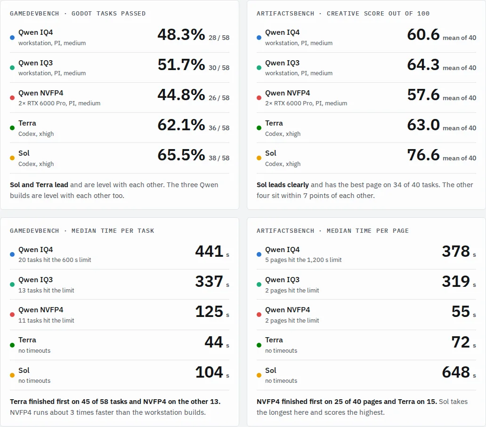

*The headline numbers from the [full report](/assets/reports/qwen-flash-benchmark/en.html).*

Strata has recently become one of the hottest projects in the local LLM community. This week I sampled 100 tasks from GameDevBench and ArtifactsBench to compare a locally hosted Qwen 3.8 Flash Next with GPT-6.1 Sol and GPT-6.1 Terra. I wanted to answer four questions. The short answers first:

1. **How far is Qwen 3.8 Flash Next behind workhorse models like Sol and Terra, which come with generous usage limits?** It trails by 10 to 20 percentage points on Godot game-development tasks. On creative web pages it is level with Terra but well behind Sol. On speed, Qwen on Strata is 4 to 10 times slower than Terra.
2. **Is IQ3_S really almost as good as IQ4?** Yes. In this run IQ3_S was even slightly better (within noise), and faster.
3. **How does the normal IQ4 compare with the abliterated IQ4?** There is essentially no difference on either benchmark.
4. **How much does high-end inference hardware help with timeouts, and does it perform differently from Strata?** NVFP4 on two RTX 6000 Pro GPUs under SGLang cut the time per task to between a third and a seventh. Godot timeouts dropped from 20 to 11. But quality did not improve: its creative pages scored the lowest of all five setups.

## How it was tested

Five setups plus one reference build, each a complete stack of model, inference server and agent harness. The three Qwen setups share the harness and settings; only the quantization and hardware differ.

| Setup | Model and quantization | Server and hardware | Agent harness | Reasoning effort |
| --- | --- | --- | --- | --- |
| Qwen IQ4 | Qwen 3.8 Flash Next, Unsloth UD-IQ4_XS | Strata; RTX 5070 Ti 16 GB, 128 GB DDR4-3200, Ryzen 9 5950X; about 57 tokens/s | PI 1.4.0 | medium |
| Qwen IQ3 | Same model, IQ3_S | Same workstation; about 75 tokens/s | PI 1.4.0 | medium |
| Qwen NVFP4 | Same model, NVFP4 | SGLang 0.5.23 on two RTX 6000 Pro GPUs; about 150–250 tokens/s | PI 1.4.0 | medium |
| Terra | GPT-6.1 Terra | OpenAI (ChatGPT login) | Codex CLI 0.166.0 | xhigh |
| Sol | GPT-6.1 Sol | OpenAI (ChatGPT login) | Codex CLI 0.166.0 | xhigh |
| Abliterated IQ4 (reference) | IQ4_XS with refusals removed | Same as Qwen IQ4 | PI 1.4.0 | medium |

- **GameDevBench**: 60 of its 333 Godot tasks. The agent changes a project, an automated check decides pass or fail, 600 s per task. Two tasks whose reference solutions also fail in my environment were dropped, leaving 58.
- **ArtifactsBench**: 40 of its 1,825 tasks, weighted toward games. Each task asks for one self-contained web page, 1,200 s per task.
- **Judging**: Claude Opus 5.5 judged the creative pages blind, two at a time, against each task's official 10-item checklist. Each page met each of its four rivals once, and its score is the average. The official judge is Gemini 2.5 Pro, so these scores only compare these setups with each other.
- **Environment**: everything ran in the same strict sandbox in one Ubuntu VM, where the agent can reach only its own model endpoint. Qwen ran one task at a time; Sol and Terra ran 2 to 4 at once.

## Question 1: how far behind Sol and Terra?

The gap is largest on Godot tasks and on speed. On creative web pages Qwen and Terra are in the same band; only Sol is clearly stronger.

| Setup | Godot pass rate (58 tasks) | Creative score (out of 100) | Godot median time per task | Creative median time per page |
| --- | --- | --- | --- | --- |
| Sol | 65.5% | 76.6 | 104 s | 648 s |
| Terra | 62.1% | 63.0 | 44 s | 72 s |
| Qwen IQ3 | 51.7% | 64.3 | 337 s | 319 s |
| Qwen IQ4 | 48.3% | 60.6 | 441 s | 378 s |
| Qwen NVFP4 | 44.8% | 57.6 | 125 s | 55 s |

- **Godot**: Sol and Terra solved 6 to 12 more tasks than Qwen. Their lead over IQ4 and NVFP4 is statistically clear (p < 0.05); their lead over IQ3 is smaller and not yet clear (p = 0.08 and 0.11).
- **Creative pages**: Sol beat every rival on 36 to 39 of 40 tasks. Terra, by contrast, is level with Qwen: judged side by side, the normal IQ4 build beat Terra 28 tasks to 12. Every Terra page works but is thin. Qwen's pages are more ambitious, but each build has 4 or 5 pages that are missing or throw errors, and Terra wins those tasks by a wide margin.
- **Speed**: Terra is the fastest and never timed out. Qwen on Strata takes 5 to 7 minutes per Godot task, and 13 to 20 of the 58 tasks ran the full 10-minute limit. On creative tasks Sol is actually the slowest; it keeps polishing, which is why it scores so high.

Note that Qwen ran at medium reasoning effort while Sol and Terra ran at xhigh. On 8 Godot tasks I tried IQ4 (the abliterated build at the time) at its highest setting: timeouts went from 2 to 6 and the pass count stayed the same.

## Question 2: is IQ3_S really almost as good as IQ4?

Yes. At this sample size IQ3_S shows no loss at all; it came out slightly ahead on every measure, and it is faster.

- **Godot**: 5 tasks only IQ3 solved, 3 only IQ4 solved (p = 0.73), a tie.
- **Creative pages**: judged side by side, IQ3 won 24 tasks and IQ4 won 16 (p = 0.27), also within noise.
- **Speed**: IQ3 decodes at about 75 tokens/s against IQ4's 57. Its median Godot time is about a quarter lower, and timeouts fell from 20 tasks to 13. That is because IQ3_S is smaller, so more of the expert weights fit in 16 GB of VRAM.

So for a 16 GB card, IQ3_S is the better deal. With one run and 98 tasks, though, "IQ3 is better than IQ4" is not a safe conclusion; "IQ3 is no worse than IQ4" is.

## Question 3: normal IQ4 vs abliterated IQ4

There is essentially no difference. Both ran on the same workstation with the same settings, and their creative scores are compared only against the three rivals both met (IQ3, Terra and Sol).

| | Normal IQ4 | Abliterated IQ4 |
| --- | --- | --- |
| Godot passed | 28 / 58 | 27 / 58 |
| Godot timeouts | 20 tasks | 17 tasks |
| Creative score (vs IQ3, Terra, Sol) | 60.4 | 59.7 |
| Missing or broken creative pages | 5 | 4 |

- **Godot**: 7 tasks only the normal build solved, 6 only the abliterated one (p = 1.0).
- **Creative pages**: judged directly against each other, the normal build won 26 tasks and the abliterated build 14 (p = 0.08). That leans toward the normal build but is not conclusive.
- **Speed**: both decode at about 57 tokens/s. In this run the normal build took longer per task (Godot median 441 s vs 354 s), and I haven't pinned down why.

Bottom line: for coding tasks, abliteration showed no measurable cost and no measurable benefit. Pick a build based only on whether you need refusals removed.

## Question 4: what does high-end inference hardware change?

Speed improves dramatically and Godot timeouts nearly halve compared with IQ4, but the pass rate does not rise, and creative quality is actually worse than both Strata builds. This setup is two RTX 6000 Pro GPUs running NVFP4 under SGLang 0.5.23, with tensor parallelism and EAGLE speculative decoding, at about 150–250 tokens/s per request.

- **Time**: the median Godot task takes about a third as long as on Strata, and the median creative page a sixth to a seventh. All 58 Godot tasks took 3.6 hours, against 5.5 to 6.8 hours on Strata; all 40 creative pages took 1.7 hours, against 4.8 to 5.7.
- **Timeouts**: Godot timeouts fell from 20 (IQ4) and 13 (IQ3) to 11. Of IQ4's 20 timed-out tasks, NVFP4 finished 11 in time but passed only 4 of them.
- **The remaining timeouts are mostly not about speed**: of NVFP4's 11 timeouts, IQ4 also timed out on 9, and all three Qwen builds timed out on 6. At this speed, 600 s is enough for several times the tokens a normal task needs, so on these tasks Qwen is more likely going in circles.
- **Godot pass rate**: 26 tasks, statistically level with Strata's 28 and 30.
- **Creative quality**: the lowest of the five setups. Side by side it lost to IQ4 (10 to 27, p = 0.008) and IQ3 (9 to 31, p < 0.001). It writes less per page (about 14k tokens against 22k to 26k on Strata), finished 3 tasks without saving a page, and answered one English prompt with a page entirely in Chinese.

The difference from Strata is not all down to quantization: the inference server is different, and its default sampling settings may be too, which I did not align this time. Also, Qwen ran one task at a time; SGLang can serve up to 16 requests at once, so total throughput with parallel runs would be higher. I didn't test that.

## Caveats

This is a quick check, and a few things limit how far the conclusions go:

- **Reasoning effort is not matched**: Qwen ran at medium, Sol and Terra at xhigh. Qwen rarely timed out on creative tasks, so rerunning them at higher effort is the most worthwhile next step.
- **One run per task, on a sample**: 98 scored tasks. Sol's creative lead, and Sol's and Terra's Godot lead over IQ4 and NVFP4, are clear; the Godot differences among the three Qwen builds are all within noise.
- **The judge is not the official one**: creative scores come from Claude Opus 5.5 and can't be compared with the ArtifactsBench leaderboard. When one task was rejudged, the same page's score moved 7 points, a rough measure of judge noise.
- **Time was not measured under equal conditions**: Sol and Terra used OpenAI's service, 2 to 4 tasks at once, so their times also depend on that service's load.

## Appendix: the full test report

Per-task results, every chart, side-by-side screenshots for four tasks and the full method are in the report: [Qwen 3.8 Flash (three deployments) vs GPT-6.1 Sol vs GPT-6.1 Terra](/assets/reports/qwen-flash-benchmark/en.html).

Benchmarks: [GameDevBench](https://github.com/waynchi/gamedevbench), [ArtifactsBench](https://github.com/Tencent-Hunyuan/ArtifactsBenchmark).
